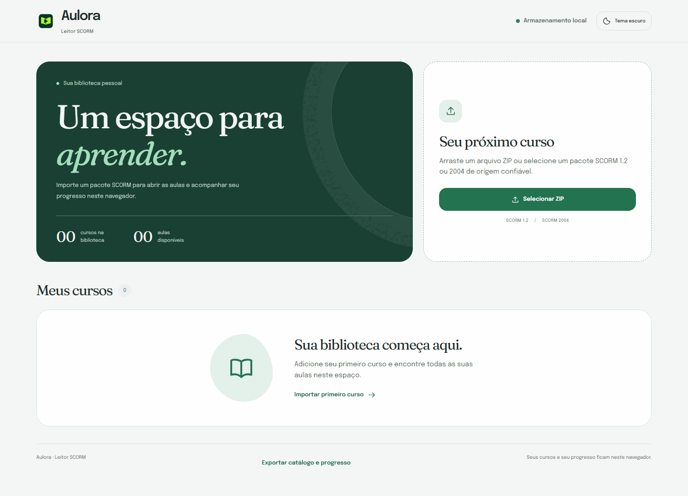

<div align="center">


# Aulora

**Seus cursos, seu ritmo, seu espaço para aprender.**

Importe pacotes SCORM, organize sua biblioteca e retome suas aulas no navegador.


[Sobre](#sobre-o-projeto) · [Demonstração](#demonstração) · [Recursos](#recursos) · [Como usar](#como-usar) · [Instalação](#instalação-e-execução) · [Desenvolvimento](#desenvolvimento-e-qualidade)

</div>

## Sobre o projeto

O **Aulora** é um leitor local de cursos SCORM. Ele permite importar pacotes educacionais em ZIP, navegar pelas aulas e acompanhar o progresso informado pelo conteúdo, sem configurar um sistema de gestão de aprendizagem (**LMS**).

A biblioteca reúne os cursos no navegador, com busca por título, indicadores de conclusão e temas claro e escuro. Os arquivos dos cursos e os dados de aprendizagem ficam armazenados no navegador utilizado, sem exigir cadastro ou um servidor de aplicação com banco de dados.

O projeto atende à reprodução e à revisão local de conteúdos. Seu runtime implementa um subconjunto das APIs **SCORM 1.2 e 2004**; sequenciamento SCORM 2004 e certificação de conformidade ficam fora do escopo.

## Demonstração

<p align="center">
  
</p>

A demonstração utiliza um curso de exemplo para apresentar a importação de um ZIP, a navegação pelas aulas, a atualização do progresso e a retomada do conteúdo. Também mostra a alternância entre os temas claro e escuro.

## Recursos

- **Importação de cursos:** selecione ou arraste um ZIP com `imsmanifest.xml` para adicionar o conteúdo à biblioteca.
- **Biblioteca pessoal:** busque cursos por título, consulte a quantidade de aulas e remova conteúdos com seu progresso local.
- **Navegação por aulas:** acesse as aulas identificadas no manifesto e utilize o player em tela cheia.
- **Acompanhamento e retomada:** preserve status, pontuação e dados de retomada enviados pelo curso à API SCORM.
- **Continuar curso:** reabra a última aula pendente. Se ela já estiver concluída, o leitor seleciona outra ainda não concluída; cursos finalizados oferecem revisão.
- **Progresso nos cards:** veja percentual concluído, aulas finalizadas, próxima aula e data do último acesso diretamente na biblioteca.
- **Resultados por aula:** consulte conclusão, nota e aprovação, mantendo a escala informada pelo conteúdo.
- **Diagnóstico SCORM:** acompanhe a inicialização da API, os erros, o salvamento e as últimas chamadas da aula; exporte um relatório para análise.
- **Salvamento automático:** grave alterações pendentes periodicamente e antes de navegar entre aulas ou voltar à biblioteca.
- **Recuperação de dados:** exporte catálogo e progresso e reinicie dados inválidos com uma cópia de segurança local.
- **Interface responsiva:** utilize a biblioteca e o player com temas claro e escuro.
- **Importação controlada:** limites de tamanho e quantidade de arquivos, validação de caminhos e limpeza de importações incompletas.

## Como usar

1. **Importe um curso:** arraste um pacote ZIP para a área de importação ou clique em **Selecionar ZIP**.
2. **Abra o conteúdo:** encontre o curso na biblioteca e clique em **Começar curso**, **Continuar curso** ou **Revisar curso**, conforme seu progresso.
3. **Escolha uma aula:** utilize o menu do player para navegar pelo conteúdo.
4. **Continue depois:** reabra o curso no mesmo navegador e endereço para recuperar os dados salvos.
5. **Guarde uma cópia:** utilize **Exportar catálogo e progresso** e mantenha os ZIPs originais dos cursos.

A retomada depende dos dados que cada curso envia ao runtime. Conteúdos que utilizam mídias ou serviços externos podem precisar de conexão com a internet.

### Resultados e diagnóstico

Abra **Resultados por aula** no card ou abaixo do player para consultar as informações enviadas pelo conteúdo. O percentual do curso corresponde à proporção de aulas concluídas. Aprovação e conclusão são tratadas separadamente no SCORM 2004; o leitor não calcula uma média geral nem deduz aprovação a partir da nota. Valores ausentes aparecem como **Não informada**, e notas normalizadas mantêm sua escala de -1 a 1.

O painel **Diagnóstico SCORM**, abaixo do player, mostra carregamento, inicialização, último código SCORM e estado de gravação. Ele mantém até 200 eventos em memória por aula, sem registrar os valores de respostas, `suspend_data` ou identificação do aluno. **Exportar diagnóstico** gera um JSON com o estado e os eventos da sessão atual; o registro é reiniciado ao trocar de aula.

### Seus cursos e seu progresso

Os arquivos dos cursos ficam na **Cache Storage**; o catálogo, as preferências e o progresso ficam no **localStorage**. A biblioteca pertence à origem do aplicativo: mudar protocolo, endereço ou porta pode abrir uma biblioteca diferente. Limpar os dados do site remove os cursos e o progresso daquela origem.

O player salva alterações pendentes a cada segundo, ao ocultar a página e antes de trocar de aula ou voltar à biblioteca. Também tenta salvar ao recarregar ou fechar a página. Se uma gravação falhar, os botões de navegação do leitor mantêm a aula aberta e exibem uma mensagem. Um encerramento forçado do navegador ou do sistema ainda pode perder alterações recentes.

### Exportação e recuperação

| Ação                              | Comportamento                                                                                                          |
| --------------------------------- | ---------------------------------------------------------------------------------------------------------------------- |
| **Exportar catálogo e progresso** | Gera um JSON com os valores locais e as cópias de recuperação.                                                         |
| **Reiniciar catálogo**            | Guarda uma cópia local do valor original e inicia uma biblioteca vazia. Preserva os arquivos e o progresso anteriores. |
| **Reiniciar progresso da aula**   | Guarda uma cópia local do valor original e permite começar a aula novamente.                                           |

Dados inválidos ou formatos desconhecidos não são sobrescritos automaticamente. A reinicialização exige confirmação e é interrompida se não for possível gravar a cópia de segurança.

**O JSON exportado não inclui os arquivos dos cursos nem oferece restauração automática.** Guarde os ZIPs originais. Reimportar um pacote cria um curso com um novo identificador; a associação com o progresso anterior exige recuperação manual.

## Instalação e execução

### Pré-requisitos

- **Bun 1.4.4**, conforme o campo `packageManager` de [package.json](package.json).
- **Node.js** compatível com a versão do Vite instalada.
- **Navegador atualizado** com suporte a Service Workers, Cache Storage e localStorage.

### Desenvolvimento local

No terminal, dentro da pasta do projeto:

```sh
bun install
bun run dev
```

Abra o endereço informado pelo Vite no terminal. Utilize **localhost ou HTTPS** para permitir o funcionamento do Service Worker que entrega os arquivos dos cursos.

### Aplicação compilada

```sh
bun run build
bun run preview
```

O build verifica os tipos e gera a aplicação em `dist/`. O comando de preview permite conferir essa versão localmente; para hospedá-la, utilize um servidor de arquivos estáticos com HTTPS.

Mantenha o terminal aberto durante a execução local. Para encerrar o servidor, pressione `Ctrl+C`.

## Compatibilidade e limites

Importe apenas **pacotes de origem confiável**. Os cursos executam JavaScript na mesma origem do leitor para descobrir a API SCORM e podem acessar os dados locais do aplicativo. O player atual não isola conteúdo não confiável.

| Recurso                     | Limite por importação |
| --------------------------- | --------------------- |
| ZIP comprimido              | 200 MiB               |
| Entradas, incluindo pastas  | 10.000                |
| Arquivo individual extraído | 128 MiB               |
| Total extraído              | 500 MiB               |
| Manifesto XML               | 2 MiB                 |

Os bytes são contados durante a extração. Caminhos absolutos, segmentos de traversal (`..`) e barras invertidas são rejeitados. Falhas na extração, no armazenamento dos arquivos ou no cadastro do curso descartam o cache parcial. A quota disponível no navegador pode ser menor que os limites acima.

A reprodução local não substitui a validação do pacote no LMS de destino. O suporte é limitado ao runtime implementado e ao comportamento de cada conteúdo.

## Tecnologias

| Área                    | Tecnologias                  | Aplicação no projeto                                  |
| ----------------------- | ---------------------------- | ----------------------------------------------------- |
| Interface               | React e TypeScript           | Componentes, estado e tipagem dos dados.              |
| Estilização             | Tailwind CSS                 | Layout responsivo, componentes e temas.               |
| Desenvolvimento e build | Bun e Vite                   | Dependências, scripts e compilação.                   |
| Persistência            | localStorage e Cache Storage | Catálogo, progresso e arquivos dos cursos.            |
| Reprodução local        | Service Worker               | Entrega dos arquivos extraídos aos iframes das aulas. |
| Pacotes                 | JSZip                        | Leitura e extração dos arquivos ZIP.                  |
| Qualidade               | Biome e Playwright           | Formatação, análise estática e testes no navegador.   |

## Desenvolvimento e qualidade

### Comandos

| Comando                      | Descrição                                                                |
| ---------------------------- | ------------------------------------------------------------------------ |
| `bun run dev`                | Inicia o servidor de desenvolvimento.                                    |
| `bun run build`              | Verifica o TypeScript e compila a aplicação em `dist/`.                  |
| `bun run preview`            | Serve a aplicação compilada para conferência local.                      |
| `bun run check`              | Verifica a arquitetura, os ciclos de dependência, o lint e a formatação. |
| `bun run check:architecture` | Verifica as fronteiras entre camadas e os ciclos de dependência.         |
| `bun run format`             | Aplica a formatação e as correções seguras do Biome.                     |
| `bun run test`               | Executa os testes de integração com Playwright.                          |
| `bun run test:ui`            | Abre a interface interativa de testes do Playwright.                     |

### Validação

Instale o navegador utilizado pelos testes e execute as verificações:

```sh
bunx playwright install chromium
bun run check
bun run build
bun run test
```

Para utilizar o Edge instalado no Windows, configure a sessão do PowerShell:

```powershell
$env:PLAYWRIGHT_CHANNEL = 'msedge'
bun run test
```

O Playwright inicia seu próprio servidor Vite. Os testes utilizam pacotes SCORM gerados durante a execução e contextos de navegador isolados, sem acessar a biblioteca pessoal. A cobertura inclui importação, navegação, retomada, salvamento automático, falhas de armazenamento, recuperação de dados, migração do catálogo e remoção de cursos.

## Arquitetura

O código está organizado em camadas e funcionalidades:

- **`domain`**: modelos de curso, regras de progresso e runtime SCORM, independentes do navegador.
- **`application`**: operações de biblioteca, reprodução, resumo de progresso e backup.
- **`infrastructure`**: importação de ZIPs, leitura de XML, armazenamento e integrações com o navegador.
- **`features`**: componentes e hooks de biblioteca, player, resultados, diagnóstico, backup e tema.
- **`app` e `shared`**: composição da aplicação, estilos globais e elementos compartilhados.

Consulte o [guia de arquitetura](docs/architecture.md) para entender os fluxos, as dependências permitidas e onde adicionar novas funcionalidades.

## Autor

Desenvolvido por **Jonatán Paes**.

[LinkedIn](https://www.linkedin.com/in/jonatanpaes/)
