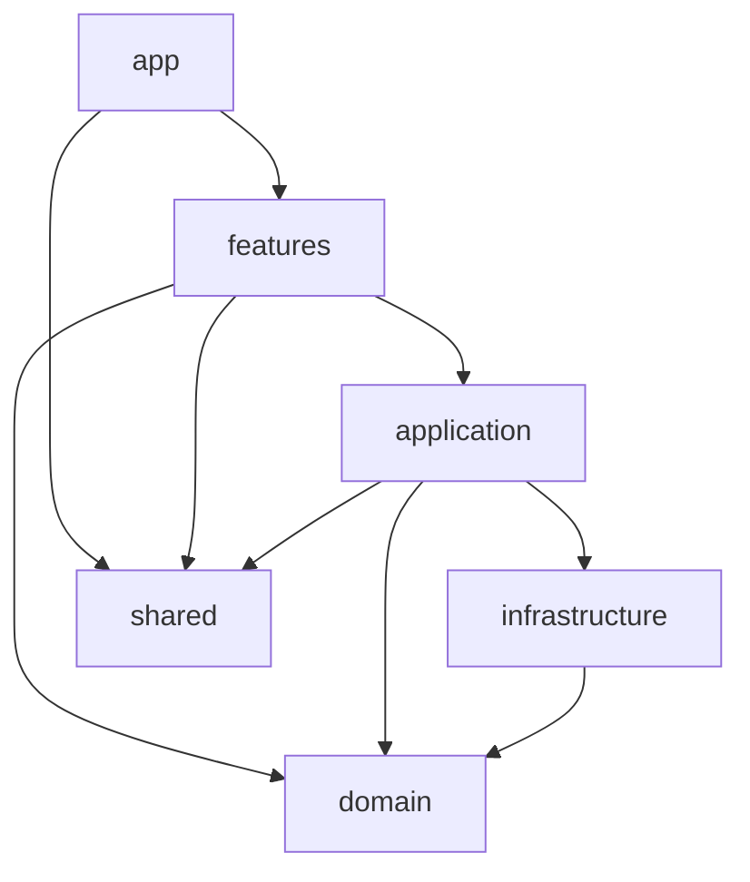

# Arquitetura do Aulora

O projeto separa as regras de cursos e SCORM das integrações com o navegador e da interface React. A organização combina camadas com componentes agrupados por funcionalidade.

## Estrutura

```text
src/
├── main.tsx
├── app/
│   ├── app.tsx
│   ├── app-header.tsx
│   └── styles.css
├── domain/
│   ├── course.ts
│   ├── course-progress.ts
│   └── scorm/runtime.ts
├── application/
│   ├── library-service.ts
│   ├── get-course-progress.ts
│   ├── player-session.ts
│   └── backup-service.ts
├── infrastructure/
│   ├── scorm/
│   │   ├── course-assets.ts
│   │   ├── manifest-parser.ts
│   │   ├── package-importer.ts
│   │   ├── page-persistence.ts
│   │   ├── runtime-host.ts
│   │   └── zip-limits.ts
│   └── storage/course-repository.ts
├── features/
│   ├── library/
│   ├── player/
│   ├── progress/
│   ├── diagnostics/
│   ├── backup/
│   └── theme/
└── shared/
    ├── ui/icon.tsx
    └── lib/download-json.ts
```

## Responsabilidades

| Camada           | Responsabilidade                                                   | Exemplo                                                                                                 |
| ---------------- | ------------------------------------------------------------------ | ------------------------------------------------------------------------------------------------------- |
| `domain`         | Modelos, validação e regras independentes do React e do navegador. | Status SCORM, cálculo de progresso e seleção da próxima aula.                                           |
| `application`    | Coordenação das operações do produto.                              | Importar e cadastrar um curso, desfazer uma importação incompleta e gerenciar uma sessão de reprodução. |
| `infrastructure` | Acesso às APIs e formatos externos.                                | localStorage, Cache Storage, Service Worker, XML, ZIP e exposição da API no `window`.                   |
| `features`       | Componentes e hooks organizados por funcionalidade.                | Biblioteca, player, resultados, diagnóstico e backup.                                                   |
| `shared`         | Elementos reutilizáveis sem dependência das funcionalidades.       | Ícones e download de JSON.                                                                              |
| `app`            | Composição das funcionalidades e apresentação global.              | Cabeçalho, alternância entre biblioteca e player e tema visual.                                         |

`main.tsx` apenas inicializa o React. O Service Worker permanece em `public/scorm-worker.js` para ser servido como arquivo estático no escopo do aplicativo.

## Fluxos principais

Ao importar um curso, o componente chama `useLibrary`, que coordena estado e mensagens. O serviço de biblioteca prepara a reprodução, importa o ZIP e registra o curso no repositório. Se o cadastro falhar, o serviço descarta o cache criado pela importação.

Ao abrir uma aula, `usePlayerSession` inicia uma sessão pela camada de aplicação. A sessão conecta o runtime ao repositório e aos adaptadores do navegador. O runtime recebe callbacks de persistência e diagnóstico; ele não conhece localStorage, React ou iframes. A liberação da sessão encerra o salvamento periódico e remove a API global que ela publicou.

Os componentes de cards e resultados recebem o resumo de progresso por propriedades. A leitura do repositório acontece na aplicação; as regras de notas, conclusão e retomada ficam no domínio. O resumo copia os dados recebidos antes de enriquecer o estado da última aula acessada.

## Dependências permitidas



- O domínio importa apenas arquivos do próprio domínio e não acessa APIs do navegador.
- A infraestrutura depende do domínio e de outros adaptadores de infraestrutura.
- Componentes e hooks de funcionalidades acessam a aplicação, o domínio, outras funcionalidades e recursos compartilhados; não importam adaptadores diretamente.
- `app` compõe as funcionalidades e não manipula o armazenamento.
- `shared` não importa regras de negócio ou funcionalidades.
- Imports diretos tornam as dependências explícitas. Não há arquivos de reexportação usados apenas como atalhos.

Execute `bun run check:architecture` para verificar imports, ciclos e as fronteiras entre camadas. Essa checagem também faz parte de `bun run check`.

## Onde adicionar código

| Mudança                                                  | Local                                               |
| -------------------------------------------------------- | --------------------------------------------------- |
| Nova regra de conclusão, nota ou retomada                | `domain/course-progress.ts`, com teste unitário.    |
| Novo comportamento da API SCORM                          | `domain/scorm/runtime.ts`.                          |
| Novo formato de importação ou integração com o navegador | Adaptador em `infrastructure`.                      |
| Operação que coordena arquivos, catálogo ou progresso    | Serviço em `application`.                           |
| Novo painel ou comportamento de interface                | Componente ou hook da funcionalidade em `features`. |
| Elemento visual reutilizável                             | `shared/ui`, quando houver uso compartilhado.       |

## Persistência e testes

A refatoração mantém as chaves e os formatos de catálogo, progresso, sessão e cópias de recuperação. Não é necessário reimportar cursos existentes.

`tests/aulora.spec.ts` cobre os fluxos no navegador. `tests/unit/domain.spec.ts` executa regras de progresso, runtime e persistência com armazenamento injetado, sem abrir um navegador. Componentes de apresentação recebem dados prontos, enquanto o repositório aceita uma implementação de `Storage` para os testes.
